# User Experience Design

## Prototype and Figma source

- [Open the clickable prototype](https://www.figma.com/proto/Zh9yqRML1MyTIGtzxfTCQj/CurbCut-%E2%80%93-Sprint-0-App-Map---Mobile-Wireframes?node-id=4-20&starting-point-node-id=4%3A20).
- [Open the app map and mobile wireframes in Figma](https://www.figma.com/design/Zh9yqRML1MyTIGtzxfTCQj/CurbCut-%E2%80%93-Sprint-0-App-Map---Mobile-Wireframes?node-id=0-1).

The prototype starts at Home (M01). It covers finding a building or barrier, checking entrance information, posting a report or follow-up, and browsing reports. Screen content is sample data for the Sprint 0 design; the prototype does not establish live building conditions.

## App map

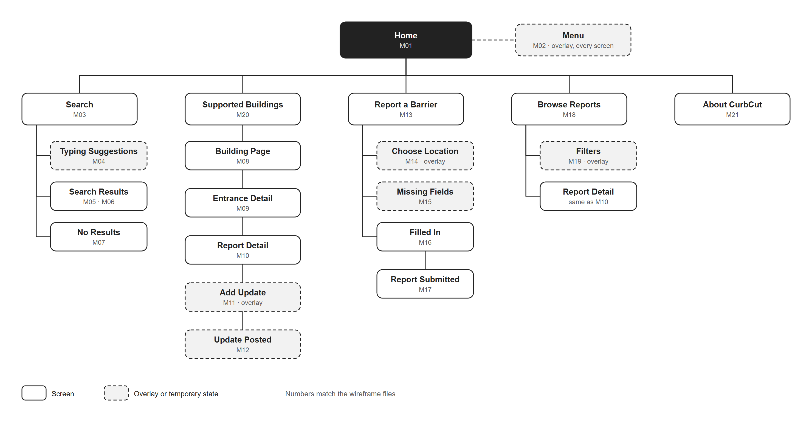

Home connects to Search, Supported Buildings, Report a Barrier, Browse Reports, and About CurbCut. Solid boxes represent screens; dashed boxes represent overlays or temporary states. The M01–M21 identifiers match the wireframes below. Report Detail is shared by the building/entrance and report-browsing paths.

## Mobile wireframes

All screens use a 390-pixel design width and are displayed at that width below. Heights vary with content. Overlay exports include the panel and its backdrop; the clickable prototype shows them over the current screen. Gray boxes represent images and other visual placeholders.

### Home and navigation

#### M01 — Home

The home screen shows recently updated barrier reports and provides entry points to search, report a barrier, browse reports, and open the menu.

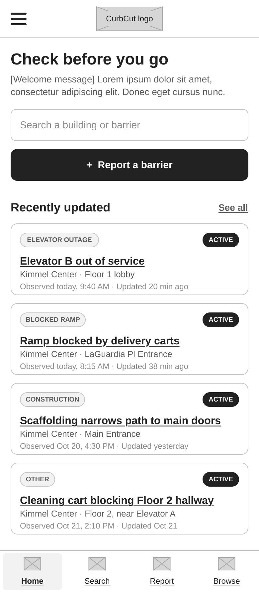

#### M02 — Menu open (overlay)

The menu provides links to Home, Search buildings, Browse reports, Report a barrier, Supported buildings, and About CurbCut. The close control returns to the underlying screen.

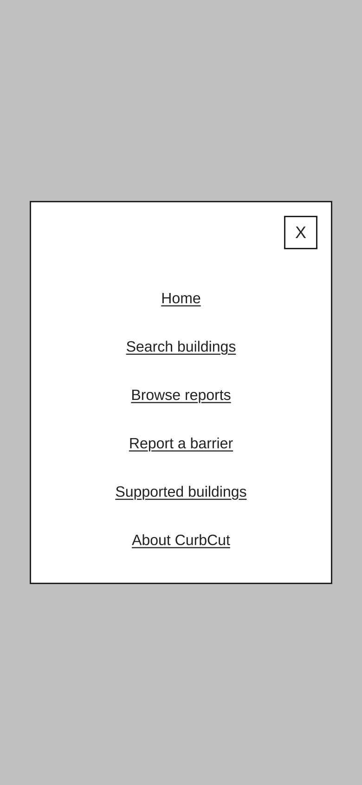

### Search

#### M03 — Search

Start a building or barrier search, repeat a recent search, or choose a supported building. The notice explains that an absence of reports does not establish accessibility.

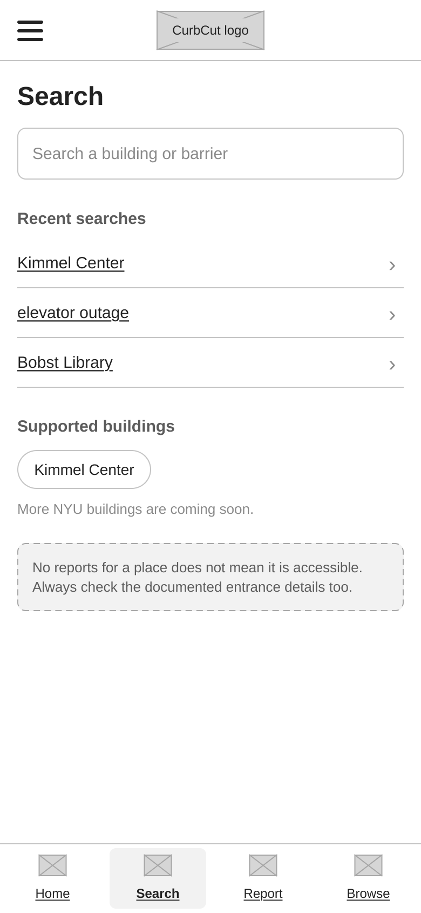

#### M04 — Search — typing suggestions

Suggestions appear while typing and distinguish a building from individual barrier reports. The on-screen keyboard is represented by a gray placeholder.

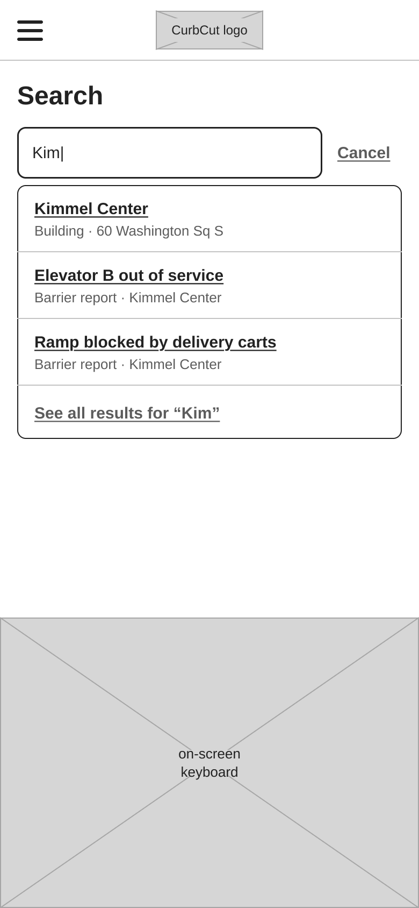

#### M05 — Search results — buildings

The Buildings tab lists matching supported buildings, with an address, active-report count, entrance count, and documented floors.

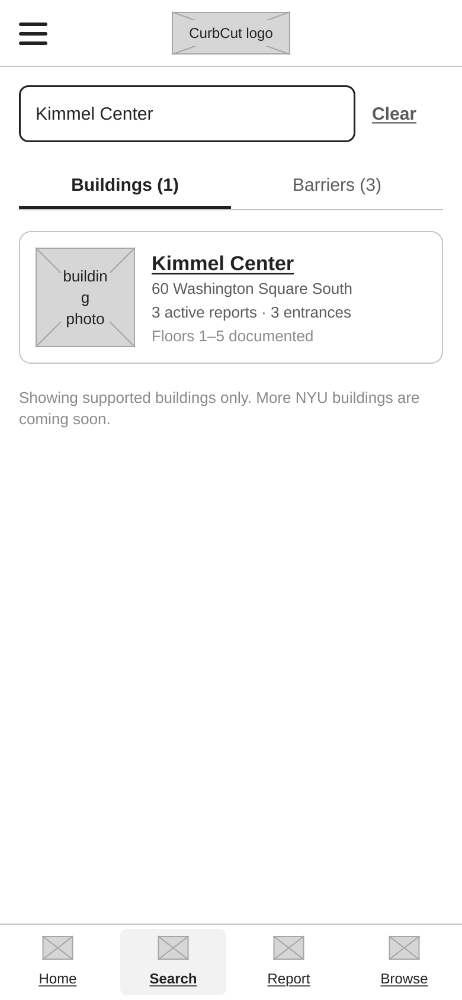

#### M06 — Search results — barriers

The Barriers tab lists matching reports with category, status, location, observation time, and update time, sorted by the latest update.

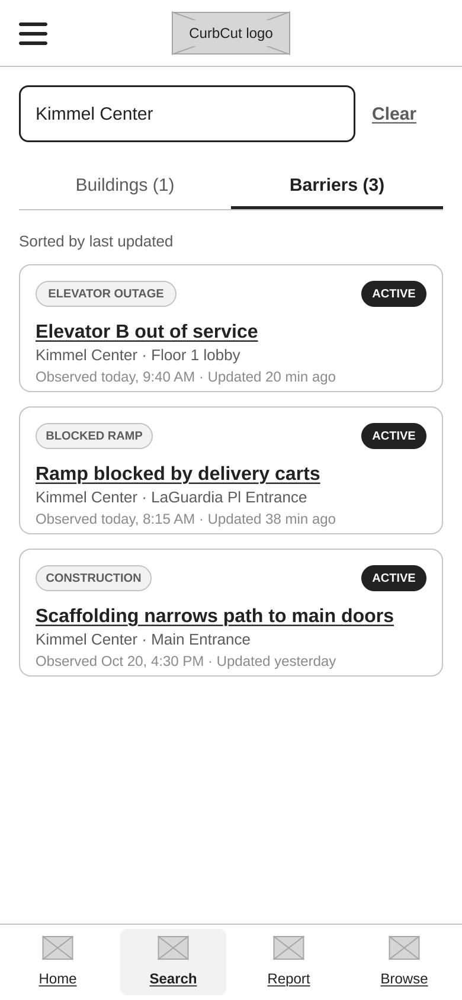

#### M07 — Search — no results

When no supported building matches, the screen explains the current coverage and offers supported buildings or a new search.

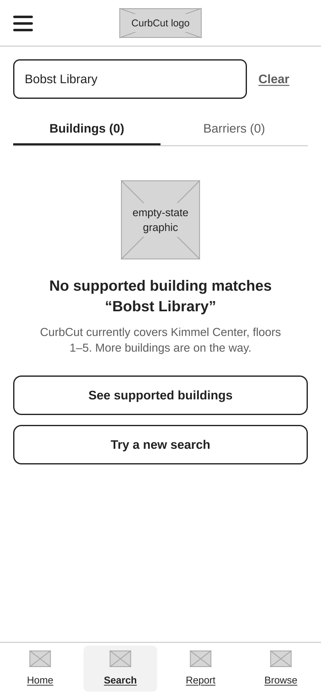

### Buildings and entrances

#### M08 — Building page

The building page separates documented entrances and floor/elevator information from community reports. Users can inspect an entrance, read recent reports, or report a barrier at the building.

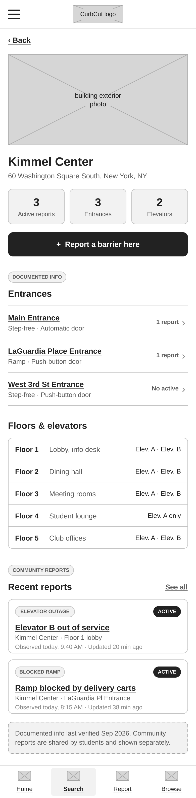

#### M09 — Entrance detail

An entrance page shows documented step-free access, door, ramp, elevator, and opening-hour details separately from community reports affecting that entrance.

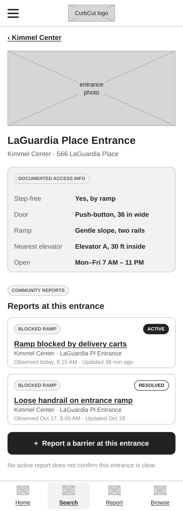

### Reports and follow-up updates

#### M10 — Report detail

A report shows its location, category, status, photo placeholder, first-observed and last-updated times, description, and update history. Users can indicate whether the barrier remains or add a follow-up.

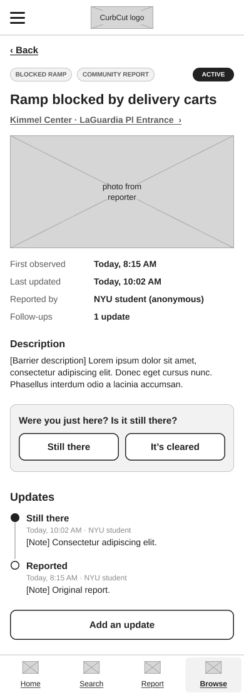

#### M11 — Add update (overlay)

Choose whether the barrier is still there, cleared, or changed, add a note, and post the update. Cancel closes the panel without posting.

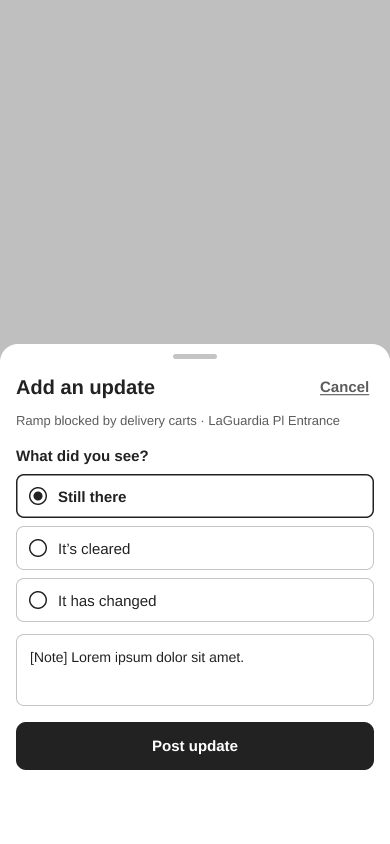

#### M12 — Report detail — update posted

A confirmation banner acknowledges the posted update. The report shows the new update in its history and an increased follow-up count.

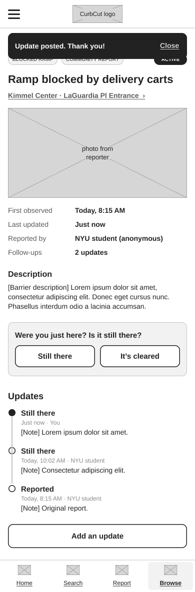

### Report a barrier

#### M13 — Report a barrier

The form collects a required location, barrier category, observation time, and description, plus an optional photo. Reports are presented as anonymous community observations.

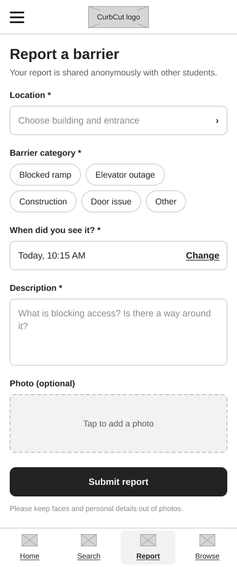

#### M14 — Choose location (overlay)

Select a supported building entrance or floor for a report. The panel includes a building search and a cancel control.

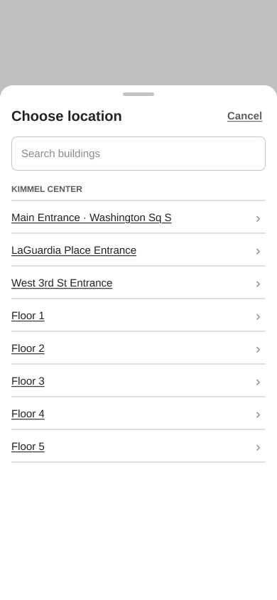

#### M15 — Report a barrier — missing fields

An incomplete submission highlights the missing location, category, and description with field-level guidance and a summary of the three required fields needing attention.

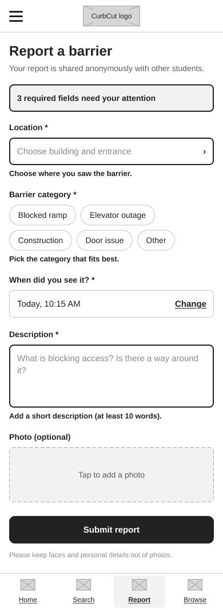

#### M16 — Report a barrier — filled in

The completed form shows selected values, a description, and an optional photo with a removal control before submission.

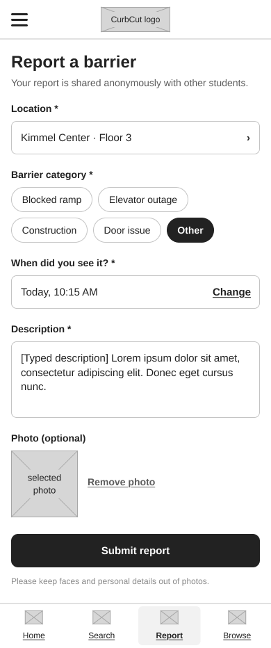

#### M17 — Report submitted

The success screen summarizes the submitted category, location, observation time, and status, with links to the building or Home.

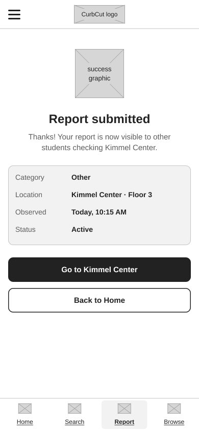

### Browse and filter reports

#### M18 — Browse reports

Browse reports using search and All, Active, or Resolved status tabs. Each report includes observation and update times; Filters refines the list and Load more reports extends it.

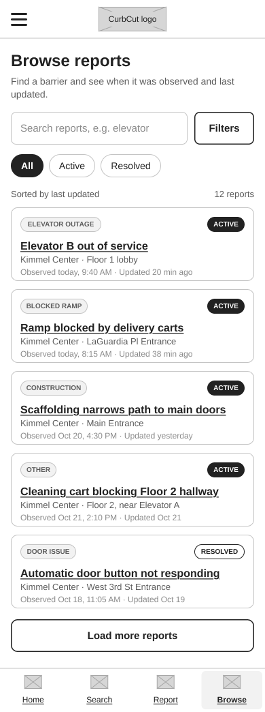

#### M19 — Filters (overlay)

Filter reports by category and observation period, choose last-updated or first-observed ordering, then show the matching reports. Reset clears the filter choices.

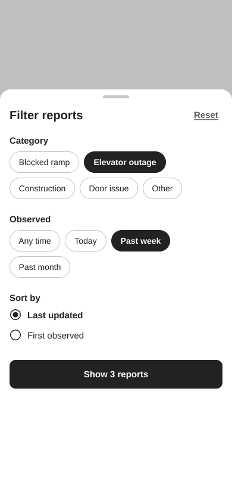

### Coverage and product information

#### M20 — Supported buildings

The screen distinguishes the available Kimmel Center coverage from other NYU buildings marked coming soon.

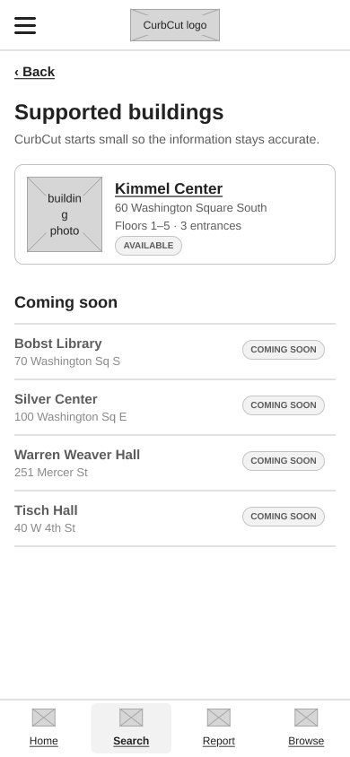

#### M21 — About CurbCut

The About screen explains the product, distinguishes documented information from community reports, and explains why no reports does not mean a location is accessible.

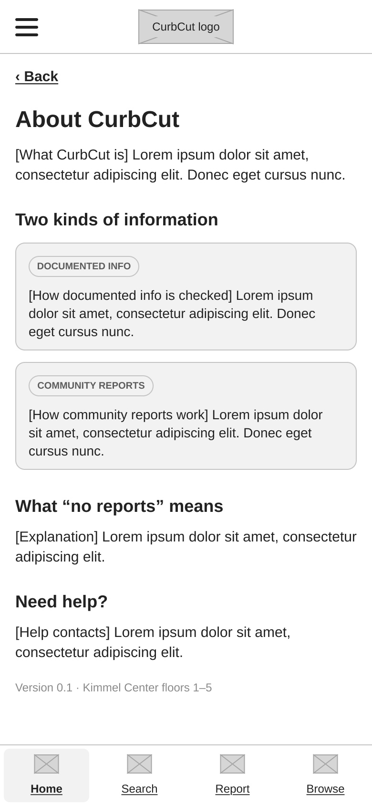

## Assignment references

- [App map and wireframe instructions](../instructions-0a-app-map-wireframes.md).
- [Prototype instructions](../instructions-0b-prototyping.md).
